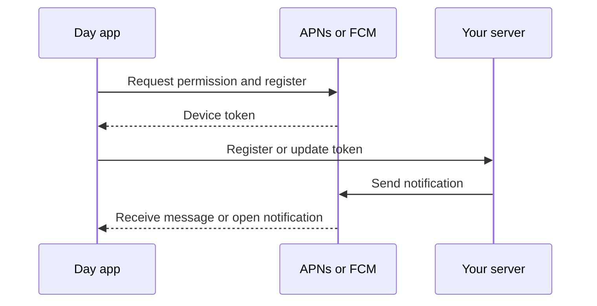

# Push notifications

Receive remote notifications in Day apps through Apple Push Notification service (APNs) and Firebase Cloud Messaging (FCM). The part handles permission requests, device tokens, incoming messages, and notification taps. Your server sends the notifications.

## Choose a backend

| Cargo feature | Backend crate | Platform |
| --- | --- | --- |
| `ios-apns` | `day-part-push-ios-apns` | iOS/UIKit |
| `android-fcm` | `day-part-push-android-fcm` | Android/Material with Google Play services |
| `relay` | Optional HTTP client | The demonstration relay in this repository |

Both native features are enabled by default. Each backend is also restricted to its target OS. Other platforms return `Error::Unsupported`.

For an Android build without Google Mobile Services:

```toml
[dependencies]
day-part-push = { version = "0.*", default-features = false, features = ["ios-apns"] }
```

This removes the FCM crate, Firebase Gradle dependency, messaging service, and generated Java bridge from Android builds. Cargo features are additive: another dependency enabling `android-fcm` will enable it for the whole application. Check the final APK as well as the Rust dependency tree. See the demo's `fcm` and `fdroid` flavors; the latter demonstrates dependency exclusion, not certification of an entire app for F-Droid.

The backend split leaves room for another Android transport. A microG-specific backend is not implemented.

## Register and listen

Subscribe before registering. Keep the returned `Watch` for as long as you need events:

```rust,no_run
use day_part_push::{self as push, Event};

async fn register() -> Result<push::Watch, push::Error> {
    let watch = push::watch(|event| match event {
        Event::Token { token } => {
            // Send the latest token to your application server over HTTPS.
            // Do not log it or use it as an account identifier.
            let _ = token;
        }
        Event::Message { payload, opened } => {
            // Use a Day Setter to hand this data to the UI thread.
            let _ = (payload, opened);
        }
        Event::Error { message } => { let _ = message; }
    })?;
    push::request_permission().await?;
    push::register().await?;
    Ok(watch)
}
```

`register()` starts registration; `Event::Token` carries the result and later rotations. Callbacks run on native delivery threads and must return promptly. Events for each subscriber are serialized. A new subscriber receives the last token and up to 32 recent messages or errors, including taps received before its page opened. Dropping `Watch` removes the subscription; an already executing callback may finish.

`unregister()` stops native registration and clears the cached token. Remove the device from your server too. A push token is specific to the app, installation, and provider environment; it can change without a user signing out.



## Native configuration

**iOS:** enable Push Notifications for the app identifier and use a provisioning profile with that capability. Include `aps-environment` in the signing entitlements. Development builds use the APNs sandbox; distribution builds use production. APNs keys stay on the sender. The part shares Day's UserNotifications delegate with local notifications. It does not provide silent-push background execution or a notification service extension.

**Android:** register the exact application ID in Firebase and add its client configuration as Android resources. The backend uses `FirebaseOptions.fromResource`; it does not require the Google Services Gradle plugin. Supply `google_app_id`, `gcm_defaultSenderId`, `google_api_key`, and `project_id` under `platform/android/res/values/`. These are client configuration values, not the service-account private key. Auto-initialization is disabled until the app calls `register()`.

Foreground messages reach `Event::Message`. In the background, FCM displays notification payloads through the OS; tapping one returns the payload to the app. Data-only delivery is subject to Android's background limits. The part does not guarantee delivery, bypass force-stop, or replace server-side account authorization.

## Try it

The [Push Lab demo](../demo/) provides register, unregister, token-copy, and event controls. It needs configuration for its own identifier, `dev.daybrite.push.demo`:

```sh
cd demo
day launch -t ios-uikit
day launch -t android-material --flavor fcm
day build -t android-material --flavor fdroid
```

Day-Showcase's Push notifications page also demonstrates enrollment and sending through the [Cloudflare relay](../relay/README.md). Sender credentials stay in Worker secrets; the app stores only a per-device credential in the keychain.

## Check

```sh
cargo fmt --all -- --check
cargo test --all-features
cargo clippy --all-targets --all-features -- -D warnings
cd relay
npm ci
npm test
```

Native builds and on-device tests are needed in addition to Rust tests. A provider accepting a send does not prove the device displayed it.

To rebuild FCM followed by the feature-disabled flavor and inspect the DEX files in both APKs:

```sh
python3 ci/check-providers.py
```

Set `DAY_BIN` if the Day CLI is not on `PATH`.
