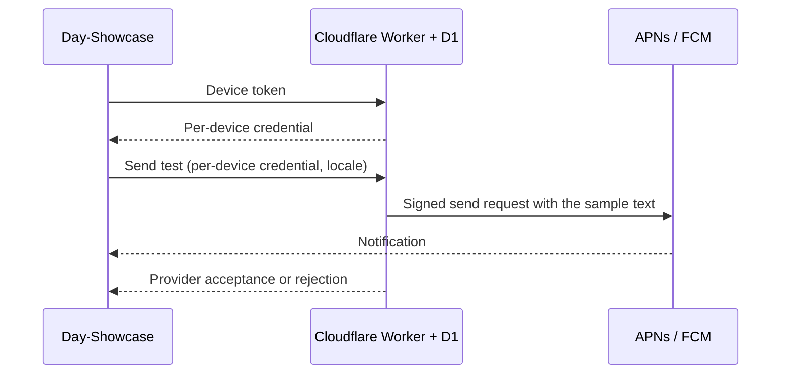

# Day push relay

A Cloudflare Worker sends test notifications to Day-Showcase installations through APNs or FCM. D1 stores device registrations. The relay has no dashboard or public broadcast endpoint.



Any installation can register its device token. A device credential can update, send to, or remove only that registration, and a device send always carries the relay's sample notification ("Hello from Day"), translated into English, French, Arabic, or Simplified Chinese according to the `locale` the app sends. Only the administrator chooses notification text. Someone who obtains another person's device token can therefore send that device nothing but the sample.

The relay bounds registrations in three ways:

- 10 registrations per network per hour, counted by IPv4 address or IPv6 /64 prefix (HTTP 429).
- 5,000 live registrations in total (HTTP 503).
- A registration expires when neither a token update nor a send has used it for 7 days. Its calls then answer HTTP 404, and the app registers again. An hourly cron trigger deletes expired rows.

Test sends are limited to one every 30 seconds per device. A test send can ask the relay to wait up to 20 seconds first (`delay`, in seconds); the relay then answers `202` at once and sends from `waitUntil`, so a provider rejection after the delay is not reported to the app. Device credentials and network addresses are stored as SHA-256 digests. Device tokens are stored in D1 so the sender can use them. APNs/FCM invalid-token responses remove a registration.

## Run locally

Requires Node with `node:sqlite` support, npm, and a Cloudflare account for deployment.

```sh
npm ci
npm test
node manage.mjs dev
```

The local server binds to `127.0.0.1:8787`, applies `schema.sql` to local D1, and reads sender credentials from the ignored `private/worker-secrets.json`. Local sends use the real provider APIs. A phone cannot reach the host's loopback interface; use the deployed HTTPS relay for device tests.

The secrets file has three keys:

- `ADMIN_TOKEN`: a random 32-byte base64url administrator credential for `manage.mjs send` and `remove`.
- `APNS_PRIVATE_KEY`: the PEM text of the Apple `.p8` signing key.
- `FCM_SERVICE_ACCOUNT`: the JSON text of a dedicated service-account key with the Firebase Cloud Messaging API Admin role.

Keep this file owner-readable only. The client `google-services.json` cannot send notifications and is not a substitute for the service-account key. Never put administrator or sender credentials in an app bundle.

## Deploy

Set the account, custom domain, APNs team/key/topic, Firebase project, and D1 binding in `wrangler.toml`. The checked-in configuration targets `push.daybrite.cloud` and `dev.daybrite.showcase`.

```sh
npx wrangler login
npx wrangler d1 execute daybrite-push --remote --file=schema.sql
npx wrangler deploy --secrets-file private/worker-secrets.json
node manage.mjs health
```

For a new account, create the D1 database first with `wrangler d1 create daybrite-push` and copy its ID into the configuration. Later deployments can use `npm run deploy`; existing Worker secrets are preserved.

APNs sandbox and production use different device tokens. Select the environment matching the app's signed entitlement. The relay restricts FCM delivery to the configured app identifier and checks that the service-account project matches `FCM_PROJECT_ID`.

## Send a test notification

In Day-Showcase, open **Push notifications** and tap **Send now** or **Send in 10 seconds**. The first send asks for notification permission, waits for the device token, and registers the device with the relay. Later sends need only the tap. Use the delayed send to leave the app or lock the device and see how the notification arrives in the background. Development builds use the APNs sandbox; the switch is under **Advanced**.

The app updates its registration when the device token changes, and registers again when the relay has expired or removed it. **Advanced → Remove from relay** deletes the server registration and local credential. It does not turn off the OS notification permission.

An administrator can send any text to a known registration, or remove it:

```sh
node manage.mjs send REGISTRATION_UUID "Hello from Day" "A test notification"
node manage.mjs remove REGISTRATION_UUID
```

Set `DAY_PUSH_RELAY` to use another HTTPS origin, or `http://127.0.0.1:8787` for local development. `DAY_PUSH_ADMIN_TOKEN` overrides the local secrets file for administrator commands.

## Limits

This is a development relay, not an account notification service. Credentials authorize one device, device sends carry only the sample text, and registrations expire after a week without use. The relay has no user accounts, topics, delivery receipts, or scheduling beyond the 20-second test delay. Provider acceptance is reported separately from device delivery. Payloads are limited to 3 KB; arbitrary provider options are not accepted.

Tests cover registration limits per network and in total, expiry and cleanup, device isolation, the fixed sample, send rate limits, token changes, removal, payload validation, signing, and both providers and the cron trigger in the Workers runtime with synthetic keys and network responses. They send no real notifications.
